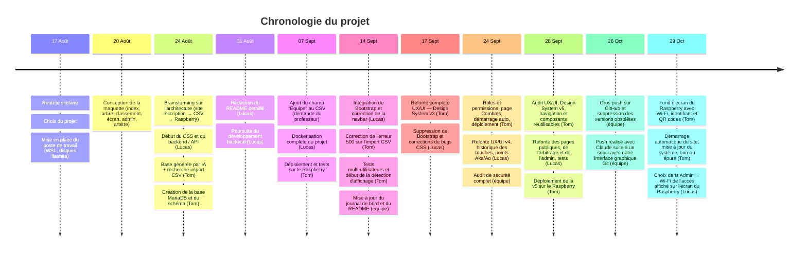
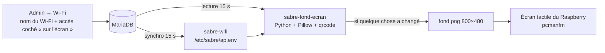

# Journal de bord



# 17.08:
## rentrée scolaire :
- choix du projet :
   - nous avons choisis ce projet car nous le trouvons intéressant, de plus, on pourra intégrer le projet de l'atelier Raspberry au site web, ce qui nous a motiver a prendre ce projet.
- mise en place du poste de travail :
   - installation des disque durs flashé:
        - installation de wsl
        - etc
# 20.08:
## Lucas :
- abscent
## Tom :
- Mise en place de la maquette :
-  Index.php  (page principal) accessible a tout le monde :
  
- arbre.php (visualisation en style "arbre") accessible par tout le monde, inspiré des images de grand tournois (coupe du monde, etc) :
  
-  classement.php, accessible par tout le monde
  
- écran.php, écran d'affichage (ex : écran principal de la salle) qui affiche en continue, les matche en cours, ceux a venir et les scores
- admin.php / dashboard, page accessible uniquement au admin, permet de gérer le tournois, lancer des matches, modifier les participant, changer les paramètres du tournois.
  
- arbitre.php, accessible uniquement aux admin ainsi que aux arbitres, sers a arbitrer les matches, donner des points au participants.
# 24.08:
## Brainstorming :
- Nous avons réfléchie a l'infrastructure du site web.
     - premièrement on pensais faire une architecture sur une seul machine, tout centralise sur le Raspberry, au final on est partie sur une architecture comme la suivante ↓
- site web inscription -> fichier Excel -> serveur Raspberry du tournoi
     - réflexion derrière ce choix : cela facilitera l'inscription de participant, car ensuite l'administrateur n'aura qu'a importer le fichier csv final et commencer le tournois.
- infrastructure  : 
## Lucas :
- Lucas a commencer a modifié le CSS crée ( / générer ) par Tom :
   - Changement de toute l'interface pour correspondre au maquette
   - Changement du CSS pour un thème plus "monochrome", plus correspondant a un site professionnel
   - dévlopement du backend notamment l'api:
        - l'api retourne sur un match renseigne via son id, celle si retourne notamment son status, le score des deux joueurs, le temps restant, le vainqueur etc    
## Tom :
   - Tom a générer grâce a l'intelligence artificiel, une base utilisable du projet, celle ci ayant pleins de problème devra être complétement modifier, mais elle donne une pour le style css, par exemple.
   - problème rencontrer : l'importation d'un fichier csv en donne php :
        - la documentation de php présente des fonctions qui nous sers pour résoudre ce probleme :
        - [premier liens](https://www.php.net/manual/en/ref.filesystem.php) les fonctions filesysteme.
        - et notamment la fonction [fgetcsv](https://www.php.net/manual/en/function.fgetcsv.php)
     - Commencement du développement du backend / base de donnée, création du la base mariadb, et de la création du schème de db.
# 31.08:
## Lucas:
- Création et rédaction plus poussé du README.MD.
   - Ajouts d'une documentation plus poussé sur les technologie utilise pour ce projet, architecture du projet explique plus en détails
   - continuer le développement du backend
## tom:
- absent
# 07.09:
## Lucas :
- absent
## Tom :
- Dockerisation complète de l'application :
   - création du `Dockerfile` :
        - image de base `php:8.2-apache`
        - installation des extensions PHP nécessaires : `pdo`, `pdo_mysql`, `mysqli`
        - activation du module Apache `mod_rewrite`
        - intégration d'un script `entrypoint.sh` qui attend que MariaDB soit prêt avant de démarrer Apache
   - création du `docker-compose.yml` :
        - service `web` (PHP 8.2 + Apache) exposé sur le port `8080`
        - service `db` (MariaDB 11) avec healthcheck automatique
        - volume persistant `db_data` pour les données de la base
        - passage des credentials via variables d'environnement
   - création du fichier `docker/apache.conf` :
        - configuration du VirtualHost Apache avec `AllowOverride All`
   - création du fichier `docker/entrypoint.sh` :
        - script bash qui teste la connexion PDO à MariaDB en boucle avant de lancer Apache
   - création du fichier `docker/init.sql` :
        - fusion de `sql/schema.sql` et de toutes les migrations en un seul fichier SQL
        - exécuté automatiquement par MariaDB au premier démarrage du conteneur
        - problème rencontré : la commande `SOURCE` de MariaDB ne fonctionne pas dans le conteneur car il n'a pas accès aux fichiers PHP — résolution en concaténant directement tous les fichiers SQL en un seul `init.sql`
   - création des fichiers `.env` / `.env.example` :
        - variables configurables : `APP_PORT`, `DB_ROOT_PASSWORD`, `DB_NAME`, `DB_USER`, `DB_PASS`, `BASE_URL`
   - création du `.dockerignore` :
        - exclusion de `.env`, `.git`, `*.md`, `docker-compose*.yml`
   - modification de `config/database.php` :
        - remplacement des credentials codés en dur par des appels `getenv()` avec valeur par défaut
   - modification de `config/config.php` :
        - `BASE_URL` désormais lu depuis la variable d'environnement (plus de chemin `/webapp_arbitrage/` codé en dur)
   - mise à jour du `README.md` :
        - section Docker placée en tête avec les 3 commandes clés (`up --build`, `down`, `down -v`)
        - tableau des variables d'environnement `.env`
        - procédure de réinitialisation de la base documentée
        - installation manuelle conservée en dessous pour référence
- résultat : l'application se lance avec une seule commande :
   ```
   docker compose up --build
   ```
   Le site est accessible sur http://localhost:8080, la base de données est initialisée automatiquement.

---

# 29.10.2026 :

## Brainstorming :
- Objectif de la séance : rendre le Raspberry **autonome et lisible pour le public** de la salle :
  - l'écran du Raspberry doit afficher en permanence **comment se connecter** : nom du Wi-Fi, mot de passe, identifiant du portail et un **QR code** pour ouvrir le site ;
  - le site doit **démarrer tout seul** dès qu'on allume le Raspberry, sans taper de commande ;
  - le bureau doit être **épuré** : plus d'icônes (terminal, explorateur de fichiers, fichiers du bureau), seulement un **raccourci** vers le site ;
  - les infos affichées doivent être **les mêmes que dans Admin → Wi-Fi**, et se mettre à jour toutes seules quand on les change dans l'app.
- Choix : au départ le site s'ouvrait automatiquement en plein écran (mode kiosque), mais il cachait le fond d'écran avec les QR codes. On a préféré un **simple raccourci**, qui ouvre le site dans une fenêtre normale du navigateur.
- Contrainte de sécurité : les mots de passe des comptes Wi-Fi sont stockés **hachés** (illisibles) en base. Le Raspberry ne peut donc pas les afficher. Solution retenue : dans Admin → Wi-Fi, on **choisit un seul accès** à afficher sur l'écran, et seul celui-ci garde son mot de passe en clair (il est de toute façon visible sur l'écran).



## Lucas :

### Choix de l'accès affiché sur l'écran (`admin/wifi.php`, `includes/wifi.php`)
- Nouvelle colonne `ecran_mdp` dans la table `wifi_comptes` (créée automatiquement) : seul l'accès affiché sur l'écran garde son mot de passe en clair, tous les autres restent hachés.
- Fonctions `wifiAfficherSurEcran()` et `wifiRetirerDeEcran()` : un seul accès peut être affiché à la fois.
- Dans le formulaire d'un accès (création et modification) : interrupteur **« Afficher sur l'écran du Raspberry »**. Sans nouveau mot de passe saisi, un mot de passe est généré (l'ancien n'étant pas relisible).
- Dans la liste : badge **« Sur l'écran »** et action **« Retirer de l'écran du Raspberry »** ; dans la carte du point d'accès : ligne « Sur l'écran du Raspberry ».
- Cohérence automatique : changer ou régénérer le mot de passe de l'accès affiché met l'écran à jour ; le désactiver ou le supprimer le retire de l'écran.

### Tests effectués
- Vérification de la syntaxe PHP dans le conteneur (`php -l`).
- Vérification du mot de passe d'un accès existant en recalculant son hachage NT : la description de l'accès contenait une faute de frappe, le vrai mot de passe a été retrouvé et l'accès a été coché « sur l'écran » sans le changer.

## Tom :

### Accès au Raspberry
- Connexion SSH par **clé** (`ssh-ed25519`) au lieu du mot de passe, pour pouvoir déployer et vérifier depuis le PC.
- Comparaison des fichiers du projet entre le PC et le Raspberry (empreintes `md5`) : le code du site sur le Pi était déjà à jour.

### Fond d'écran avec les infos de connexion (`raspberry/sabre-fond-ecran.py`)
- Script Python (Pillow + `qrcode`) qui dessine un fond d'écran à la taille de l'écran branché (écran tactile DSI 800×480) :
  - **1. Rejoindre le Wi-Fi** : nom et mot de passe (ou « réseau ouvert ») ;
  - **2. S'identifier** : identifiant + mot de passe de l'accès coché dans Admin → Wi-Fi ;
  - **3. Ouvrir le site** : `http://sabre.lan` ;
  - deux **QR codes** : un pour rejoindre le Wi-Fi d'un coup (format `WIFI:T:…;S:…;;`), un pour ouvrir le site.
- Lancé toutes les 15 secondes par un minuteur systemd (`sabre-fond-ecran.timer`), mais l'image n'est **redessinée que si une information a changé** (empreinte SHA-256 des données).
- Si la base de données est arrêtée, le dernier accès connu est gardé ; si aucun accès n'est coché, un **compte de secours** `invite` (local au Pi) est affiché.
- Application du fond d'écran dans la session ouverte (`pcmanfm --set-wallpaper`).

### Démarrage automatique et mise à jour (`raspberry/install_ecran.sh`)
- Mise à jour complète du système (`apt full-upgrade`) et installation de `python3-qrcode`.
- Nouveau service **`sabre-app`** : lance `docker compose up -d` à chaque démarrage du Raspberry.
- Reconstruction et relance de l'application (`docker compose up -d --build`).

### Bureau épuré + raccourci vers le site (`raspberry/install_raccourci.sh`)
- Raccourci **« Sabre Arbitrage »** (icône de l'app) sur le bureau et dans la barre des tâches : ouvre le site dans le navigateur, comme un favori.
- Icônes du bureau masquées (fichiers, corbeille, clés USB) sans supprimer les fichiers du dossier Bureau.
- Raccourcis navigateur / explorateur de fichiers / terminal retirés de la barre des tâches.
- Option `--desinstaller` pour tout remettre comme avant (copie des anciens réglages en `*.avant-kiosque`).

### Problèmes rencontrés et solutions
- **`sudo` demande un mot de passe** sur le Pi : les installations système (services, paquets) sont regroupées dans `install_ecran.sh`, lancé une seule fois avec `sudo`. Le bureau et le raccourci se configurent sans `sudo` (`install_raccourci.sh`).
- **Chromium ne démarrait pas** depuis SSH (`Missing X server or $DISPLAY`) : le bureau tourne sous Wayland (labwc), ajout de `--ozone-platform=wayland`.
- **Le titre du fond d'écran passait sous la barre des tâches** sur le petit écran : titre descendu et sous-titre masqué sur les écrans de moins de 720 px de haut.
- **Le plein écran automatique cachait le fond d'écran avec les QR codes** : remplacé par un raccourci.
- **`pkill -f` a coupé la session SSH** (le motif apparaissait dans sa propre commande) : remplacé par `pkill -x`.

### Tests effectués
- Captures de l'écran du Pi (`grim`) : fond d'écran, bureau sans icônes, raccourci qui ouvre le site.
- Après redémarrage du Raspberry : tous les conteneurs relancés seuls, site en `200`, Wi-Fi et portail actifs, fond d'écran recréé.

## Résultat commun :
- En allumant le Raspberry, le site démarre tout seul et l'écran affiche le Wi-Fi, l'identifiant, le mot de passe et les QR codes.
- Les infos de l'écran sont celles d'**Admin → Wi-Fi** et se mettent à jour d'elles-mêmes en ~15 secondes.
- Le bureau ne montre plus qu'un raccourci vers le site.
- ⚠️ Le tunnel Cloudflare (`sabre_tunnel`) redémarre aussi avec le Pi : le site reste accessible depuis internet tant qu'il tourne.
