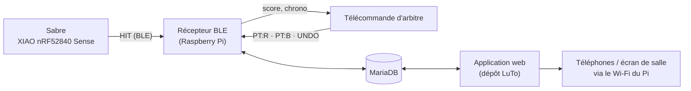

# ⚡ CuTo — Sabres connectés, télécommandes et Raspberry Pi

Partie **matérielle** du projet Sabre Laser Arbitrage : les sabres détectent les touches et les envoient en
Bluetooth (BLE) au Raspberry Pi, les arbitres donnent leurs points avec une télécommande, et le Raspberry
diffuse le Wi-Fi du tournoi et héberge l'application.

**Projet CFPT — 2026-27, classe I.DA-P3B · Équipe : Lucas & Tom**

> L'application web (site, base de données, Docker) est dans le dépôt
> **[2026-27_I.DA-P3B_LuTo](https://github.com/CFPT-AWEB-PH/2026-27_I.DA-P3B_LuTo)**.

---

## 🧭 Fonctionnement



---

## 📁 Organisation du dépôt

| Dossier | Contenu |
|---------|---------|
| [`sabre/`](sabre/) | Firmware CircuitPython du sabre : détection des touches (accéléromètre), LED, envoi BLE |
| [`telecommandes/`](telecommandes/) | Firmware CircuitPython des télécommandes d'arbitre (boutons + écran OLED) |
| [`ble_receiver/`](ble_receiver/) | Récepteur Bluetooth (Python, Docker) : relie sabres et télécommandes à la base |
| [`raspberry/`](raspberry/) | Scripts du Pi : Wi-Fi du tournoi + portail, démarrage auto, fond d'écran avec QR codes, raccourci |
| [`docs/`](docs/) | [Cahier des charges](docs/cahier-des-charges.md) · [Journal de bord](docs/journal-de-bord.md) |

---

## 🚀 Installation

### 1. Le Raspberry Pi (application + Wi-Fi + Bluetooth)

Le récepteur et les scripts du Pi tournent **avec l'application** : on installe tout depuis le dépôt LuTo,
qui contient la même version de `ble_receiver/` et `raspberry/` dans son dossier `app/`.

```bash
git clone https://github.com/CFPT-AWEB-PH/2026-27_I.DA-P3B_LuTo.git
cd 2026-27_I.DA-P3B_LuTo/app
./install.sh                                          # application + base de données
sudo bash raspberry/install_wifi.sh --ssid "Sabre-Arbitrage" --pays CH   # Wi-Fi + portail (+ Bluetooth)
sudo bash raspberry/install_ecran.sh                  # démarrage automatique + fond d'écran
bash raspberry/install_raccourci.sh                   # bureau épuré + raccourci (SANS sudo)
```

`install_wifi.sh` ajoute le profil `ble` dans `.env` si le Pi a une puce Bluetooth : le récepteur démarre
alors avec l'application (`docker logs -f sabre_ble` pour le suivre).
Détails : [guide d'installation du dépôt LuTo](https://github.com/CFPT-AWEB-PH/2026-27_I.DA-P3B_LuTo/blob/main/docs/installation.md).

### 2. Les sabres

Voir [`sabre/README.md`](sabre/README.md) : copier `code.py` sur la carte, donner un nom à chaque sabre,
puis l'enregistrer dans **Admin › Sabres** avec son adresse MAC.

### 3. Les télécommandes

Voir [`telecommandes/README.md`](telecommandes/README.md) : copier `code.py`, donner un nom commençant par
`TEL` ; la télécommande apparaît toute seule dans **Admin › Sabres › Télécommandes**.

---

## 🛠️ Technologies

CircuitPython 10 · Bluetooth Low Energy (Nordic UART) · Python 3.11 + [Bleak](https://github.com/hbldh/bleak) ·
Docker · Raspberry Pi OS · hostapd / dnsmasq / nftables · Caddy · MariaDB
