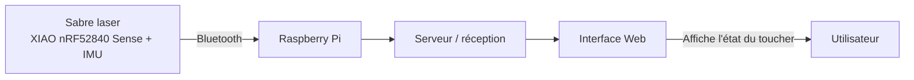
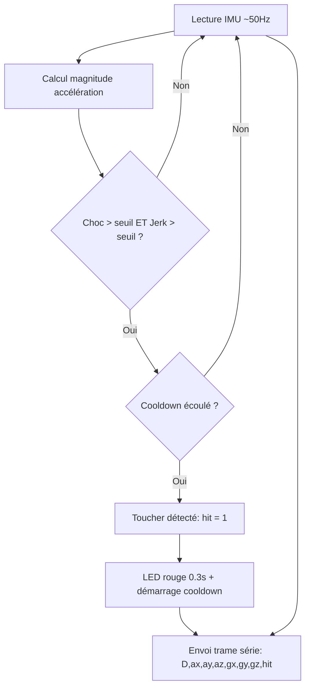
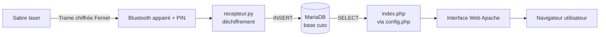
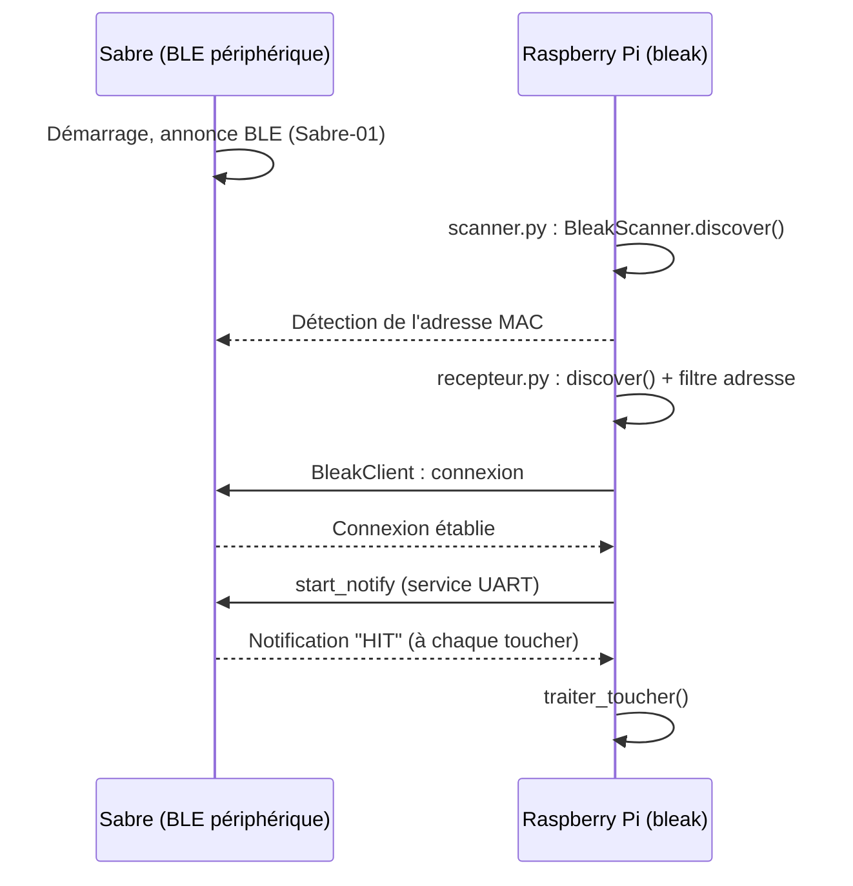
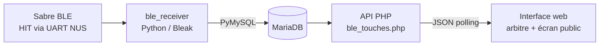
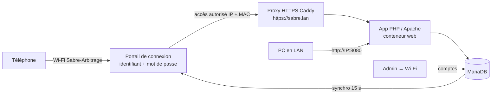
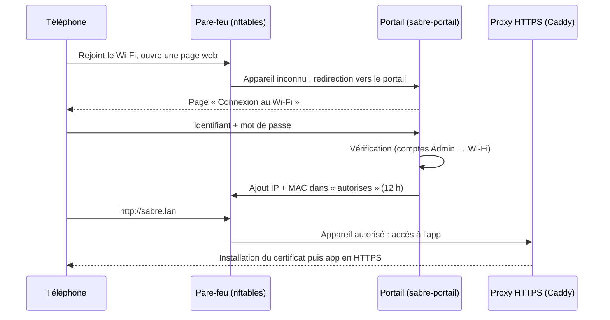
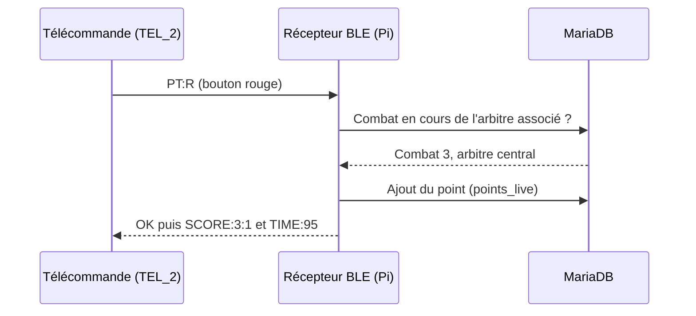

# Journal de bord

# 27.08 :

## Brainstorming :
- Réflexion sur l'implémentation générale du projet CuTo : comment faire communiquer les sabres lasers avec l'interface web.
- Discussion sur la détection des collisions (toucher) : faut-il se baser uniquement sur l'intensité du choc, ou aussi sur la brutalité du mouvement (jerk) pour ne pas confondre un vrai coup avec un simple swing rapide.
- Réflexion sur l'interprétation de la couleur du sabre selon l'état (idle / toucher détecté), en vue d'un futur retour visuel sur le sabre et/ou sur l'interface web.
- Définition de l'architecture générale du système : sabre laser → Bluetooth → Raspberry Pi → serveur → interface web.



## Lucas :
- Écriture d'un script Python de test (`code.py`) pour la détection de toucher sur le sabre laser, exécuté sur un microcontrôleur **Seeed XIAO nRF52840 Sense** (CircuitPython) équipé d'un capteur IMU **LSM6DS3TRC** (accéléromètre + gyroscope).
- Implémentation de la lecture continue de l'IMU (accélération et gyroscope) à une cadence stabilisée d'environ 50 Hz.
- Mise en place d'une **calibration automatique de la gravité locale** au démarrage (moyenne sur 100 échantillons, ~2 secondes), afin de compenser le biais propre à chaque capteur plutôt que d'utiliser une valeur fixe de 9.8 m/s².
- Implémentation de la logique de détection de toucher combinant deux critères :
  - l'**intensité du choc** (écart entre l'accélération mesurée et la gravité locale, seuil fixé à 35 m/s²) ;
  - la **brutalité du mouvement / jerk** (variation d'accélération entre deux échantillons consécutifs, seuil fixé à 18 m/s²) ;
  - un toucher n'est validé que si les deux seuils sont dépassés simultanément, ce qui permet de distinguer un vrai impact d'un simple swing rapide dans le vide.
- Ajout d'un système de **cooldown** (0,6 seconde) après un toucher détecté, pour éviter les doubles comptages.
- Gestion de la LED RGB embarquée du microcontrôleur : allumage en bleu pendant la calibration, en rouge pendant 0,3 seconde lors d'un toucher détecté, clignotement rouge continu en cas d'erreur matérielle (capteur non détecté au démarrage).
- Mise en place de l'envoi en continu, sur le port série, d'une trame de données au format :
  ```
  D,ax,ay,az,gx,gy,gz,hit
  ```
  avec `ax,ay,az` les accélérations, `gx,gy,gz` les vitesses angulaires, et `hit` valant `1` si un toucher est actif, `0` sinon.
- Tests effectués en local (branchement du sabre en USB, lecture de la sortie série) pour valider la fiabilité de la détection.



## Tom :
- Création d'une interface web de test permettant d'afficher les données reçues, en particulier l'état du toucher (`hit`).
- Objectif de cette première version : valider qu'une page web est capable de recevoir/afficher une donnée simple (toucher détecté ou non) avant d'intégrer la vraie chaîne de communication (Bluetooth + Raspberry Pi).
- Réflexion sur la structure de la future interface (affichage en temps réel, historique des touchers).

---

# 03.09 :

## Lucas :
- Absent.

## Tom :
- Mise en place complète de la configuration du **Raspberry Pi**, en vue d'y héberger le serveur et l'interface web du projet.
- **Installation de base** : flash de Raspberry Pi OS (64-bit) via Raspberry Pi Imager, activation du SSH et du Wi-Fi, création d'un utilisateur/mot de passe personnalisé (suppression des identifiants par défaut `pi`/`raspberry` pour la sécurité), mise à jour complète du système (`apt update && apt full-upgrade`).
- **Configuration Bluetooth** :
  - installation des paquets nécessaires (`bluetooth`, `bluez`, `bluez-tools`) et activation du service au démarrage ;
  - vérification de l'adaptateur Bluetooth du Raspberry (`bluetoothctl list` / `show`) ;
  - mise en place de la procédure d'appairage (pairing) avec un sabre laser via `bluetoothctl` (`scan on`, `pair`, `trust`, `connect`), à répéter pour chaque sabre.
- **Sécurisation / chiffrement de la liaison Bluetooth** :
  - configuration de `/etc/bluetooth/main.conf` pour forcer un pairing sécurisé (BLE Secure Connections) ;
  - remplacement de l'agent par défaut (`agent on`, mode "Just Works" peu sécurisé) par un agent `KeyboardOnly` demandant un code PIN à la connexion ;
  - mise en place d'une liste blanche (whitelist) d'appareils de confiance via `trust`/`remove`, pour n'autoriser que les sabres laser officiels à se connecter ;
  - ajout d'un **chiffrement applicatif** des données en complément du chiffrement natif Bluetooth : utilisation d'une clé partagée symétrique (bibliothèque Python `cryptography`, `Fernet`) pour chiffrer chaque trame côté sabre avant envoi, et la déchiffrer côté Raspberry à la réception ;
  - définition de bonnes pratiques générales : nom Bluetooth du Raspberry non identifiable, désactivation du mode `Discoverable` une fois les sabres appairés, mises à jour régulières du système, isolation du Raspberry sur un réseau Wi-Fi dédié si possible.
- **Mise en place du serveur et de l'interface web (stack Apache + PHP + MariaDB)** :
  - installation d'Apache, PHP (avec l'extension `php-mysqli`) et MariaDB ;
  - sécurisation de l'installation MariaDB (`mysql_secure_installation`) : mot de passe root, suppression des utilisateurs anonymes et de la base de test, désactivation de l'accès root distant ;
  - création de la base de données `cuto` et d'un **utilisateur applicatif dédié** (`cuto_app`) avec des droits limités (`SELECT`, `INSERT`, `UPDATE` uniquement), afin de ne jamais utiliser le compte root dans le code applicatif ;
  - conception du schéma de base de données : table `sabres` (id, nom, adresse MAC) et table `touchers` (id, sabre concerné, date/heure, intensité du choc) ;
  - définition de l'arborescence du projet : dossier web (`/var/www/html/cuto/` avec `index.php`, `config.php`, `assets/`) séparé du dossier de réception Bluetooth (`~/cuto-bluetooth/` avec le script Python `recepteur.py` et la clé de chiffrement) ;
  - écriture du fichier `config.php` de connexion à MariaDB via `mysqli`, avec consigne de ne jamais versionner ce fichier sur Git (identifiants sensibles) ;
  - mise en place du script Python `recepteur.py`, chargé de recevoir les trames Bluetooth chiffrées envoyées par les sabres, de les déchiffrer, puis d'insérer un enregistrement dans la table `touchers` de MariaDB lorsqu'un toucher est détecté (`hit == 1`) ;
  - test de lancement manuel : interface web accessible sur `http://ip_du_raspberry/cuto/`, script de réception lancé en parallèle dans son environnement virtuel Python.
- **Démarrage automatique** : création d'un service `systemd` (`cuto-bluetooth.service`) pour que le script Python de réception Bluetooth démarre automatiquement au boot du Raspberry (Apache et MariaDB étant déjà configurés pour démarrer seuls via `systemctl enable`).
- Rédaction d'un récapitulatif des points de sécurité mis en place (pairing Bluetooth sécurisé, whitelist d'appareils, chiffrement applicatif, stockage protégé de la clé, utilisateur MariaDB à droits limités, fichier `config.php` non versionné, accès réseau limité).



- **Passage au BLE (Bluetooth Low Energy)** : correction d'approche par rapport à la config initiale — le XIAO nRF52840 Sense fonctionne en BLE et non en Bluetooth classique, donc utilisation de la bibliothèque `bleak` côté Raspberry Pi (au lieu de `pybluez`, prévue pour le Bluetooth classique/SPP).
- **Ajout de la transmission BLE côté sabre** (`code.py`) : le sabre devient un périphérique BLE annonçant un service **Nordic UART Service (NUS)** via `adafruit_ble`, avec un nom personnalisable (`Sabre-01`) et l'affichage de son adresse MAC BLE sur le port série au démarrage. Envoi de la trame `"HIT"` en notification à chaque toucher détecté.
- **Récupération de l'adresse MAC du sabre** (`EF:2A:91:14:25:D3`) via le port série du sabre, puis confirmation par un script de scan BLE (`scanner.py`, basé sur `BleakScanner.discover()`) exécuté sur le Raspberry Pi.
- **Écriture du script de réception** (`recepteur.py`) : connexion en BLE au sabre via `bleak`, abonnement aux notifications du service UART, traitement de chaque `"HIT"` reçu (emplacement prévu pour l'insertion dans MariaDB).
- **Débogage de la connexion BLE** :
  - erreur `TypeError: 'bool' object is not callable` sur `client.is_connected()` → corrigée : `is_connected` est une propriété (et non une méthode) dans les versions récentes de `bleak`.
  - erreur `BleakDeviceNotFoundError` avec `BleakScanner.find_device_by_address()` → cette méthode s'est révélée peu fiable avec l'adaptateur BlueZ du Raspberry utilisé. Contournement : scan complet avec `BleakScanner.discover()` (comme dans `scanner.py`) puis filtrage sur l'adresse MAC recherchée, avant de passer l'appareil trouvé à `BleakClient`.
- **Validation** : le sabre `Sabre-01` (adresse `EF:2A:91:14:25:D3`) est correctement détecté par le scan et la connexion BLE fonctionne.
- ⚠️ À ce stade, la trame `"HIT"` est envoyée **en clair** (pas encore de chiffrement applicatif Fernet ni d'insertion MariaDB réelle) : ces deux points restent à implémenter dans une prochaine étape.



---

# 17.09 :

## Brainstorming :
- Discussion en vocal sur l'intégration du système BLE directement dans Docker : objectif qu'un seul `docker compose up --build` lance **tout** (base de données, serveur web, tunnel Cloudflare **et** daemon Bluetooth) sans configuration manuelle supplémentaire.
- Définition des règles de logique de combat :
  - Un seul sabre touche → **"TOUCHÉ"** affiché dans l'interface.
  - Deux sabres touchent dans une fenêtre de **200 ms** → **double-touche annulée**, aucun point accordé.
- Choix de l'architecture : le daemon BLE Python tourne comme 4ème service Docker (`ble_receiver`) en `network_mode: host` pour accéder au stack Bluetooth du Raspberry Pi.
- Décision du mapping sabre ↔ joueur : association fixe gérée depuis l'interface admin (chaque sabre physique est lié à un joueur en base de données).



## Lucas :
- Réflexion sur les seuils de détection côté sabre (`SEUIL_CHOC`, `SEUIL_JERK`) et discussion sur leur calibration pour différencier un vrai impact d'un swing dans le vide.
- Discussion sur le comportement de la LED lors d'une double-touche (feedback visuel à définir côté microcontrôleur).

### Nouveau service `ble_receiver/`
- **`Dockerfile`** : image Python 3.11, installation de BlueZ + D-Bus, `bleak` et `PyMySQL`.
- **`requirements.txt`** : dépendances Python (`bleak==0.22.3`, `PyMySQL==1.1.1`).
- **`receiver.py`** — daemon BLE complet :
  - Chargement des sabres actifs depuis la base de données au démarrage.
  - Connexion simultanée à tous les sabres enregistrés (une tâche asyncio par sabre).
  - Abonnement aux notifications UART (UUID `6e400003-b5a3-f393-e0a9-e50e24dcca9e`).
  - **Logique double-touche** : si deux sabres envoient `"HIT"` dans une fenêtre de 200 ms → type `'double'` pour les deux ; sinon → type `'touche'` après expiration de la fenêtre.
  - Reconnexion automatique en cas de déconnexion (retry toutes les 10 secondes).
  - Scan BLE périodique (toutes les 30 secondes) → mise à jour de `ble_scan_cache`.
  - Rechargement dynamique de la liste des sabres depuis la DB (toutes les 30 secondes), sans redémarrer le daemon.

### Nouvelles tables en base de données (`sql/migration_ble.sql`)
- **`sabres`** : id, adresse MAC, nom, joueur associé (FK), actif, last_seen.
- **`ble_scan_cache`** : cache des appareils BLE découverts lors du scan périodique.
- **`touchers`** : id, combat_id, sabre_id, joueur_id, timestamp_ms (Unix ms), type (`touche` / `double` / `annule`).

## Tom :
- Implémentation complète du système BLE dans Docker :

### Mise à jour `docker-compose.yml`
- Ajout du service `ble_receiver` avec `network_mode: host` (nécessaire pour BLE sous Linux) et `privileged: true`.
- Volume `/var/run/dbus:/var/run/dbus` pour que BlueZ puisse fonctionner dans le conteneur.
- Exposition du port `3306` de MariaDB sur `127.0.0.1` uniquement, pour que `ble_receiver` en mode host network puisse joindre la base de données.

### Nouvelle page admin `admin/sabres.php`
- Liste des sabres enregistrés avec statut de connexion en temps réel (vert = vu < 60 s, orange = vu < 5 min, rouge = hors ligne).
- Section "appareils découverts" : affiche le cache du scan BLE avec un bouton **Ajouter** pour enregistrer un nouveau sabre en un clic.
- Formulaire d'ajout manuel (MAC + nom + joueur associé).
- Modal d'édition : modifier nom, joueur associé, activer/désactiver un sabre.

### Nouvelle API `api/ble_touches.php`
- Retourne en JSON les dernières touches BLE d'un combat (`?combat_id=X&since_id=Y`).
- Utilisée en polling par le JavaScript côté client.

### Intégration dans la page arbitrage (`arbitrage/saisie.php`)
- Section **"Touches électroniques"** visible pendant un combat en cours.
- Polling JSON automatique (fréquence réglable via le paramètre `intervalle_actualisation_ms`).
- Affichage coloré : vert pour "TOUCHÉ — [Joueur]", orange pour "DOUBLE TOUCHE".
- Indicateur de statut BLE (point vert/rouge).

### Intégration dans l'écran public (`ecran.php` + `assets/js/ble_ecran.js`)
- Overlay plein écran animé qui s'affiche 2,5 secondes à chaque touche BLE détectée.
- "TOUCHÉ !" en vert avec le nom du joueur, ou "DOUBLE TOUCHE" en orange.
- Polling indépendant sur tous les combats en cours simultanément.

### Résultat
- Un seul `docker compose up --build` lance tout : base de données, serveur web, tunnel HTTPS et daemon BLE.
- Les sabres se gèrent depuis **Admin → Sabres** : scan automatique + ajout par adresse MAC.
- Les touches apparaissent en temps réel dans l'interface arbitre et sur l'écran public de la salle.

---

# 01.10 :

## Brainstorming :
- Objectif de la séance : rendre l'application **installable sur téléphone (PWA)** et transformer le Raspberry Pi en **point d'accès Wi-Fi dédié au tournoi**, sur lequel il faut s'identifier (identifiant + mot de passe) avant d'accéder à l'application.
- Contraintes définies :
  - le Wi-Fi du Raspberry est **isolé** : pas d'accès à internet, pas d'accès au réseau local de l'école, pas de SSH depuis le Wi-Fi ;
  - l'application doit **rester accessible en LAN** (`http://<IP-du-Pi>:8080`) en plus du Wi-Fi ;
  - les comptes Wi-Fi doivent se gérer **depuis l'interface admin**, sans toucher au Raspberry.
- Choix techniques : comptes gérés dans l'app (nouvel onglet **Admin → Wi-Fi**) et HTTPS avec une **autorité de certification locale** (une PWA ne s'installe qu'en HTTPS, et le Wi-Fi n'a pas internet pour obtenir un certificat Let's Encrypt).



## Lucas :

### Application installable (PWA)
- Création du **manifeste** (`assets/pwa/manifest.webmanifest`) : nom, couleurs du thème, mode plein écran (`standalone`), raccourcis (Direct, Arbitrage, Classement).
- Génération des **icônes** (192 px, 512 px, version « maskable » pour Android, icône Apple 180 px) reprenant le logo du sabre.
- Écriture du **Service Worker** (`sw.js`, à la racine) avec une stratégie prudente adaptée à une app de score en direct :
  - pages PHP et API : **toujours le réseau**, jamais de cache (pas de score périmé ni de jeton CSRF réutilisé) ;
  - fichiers statiques (CSS, JS, polices, icônes) : mis en cache pour un chargement rapide ;
  - page **« Pas de connexion »** affichée si le Wi-Fi est coupé.
- Ajout d'un bouton **« Installer l'application »** en bas de page (`assets/js/pwa.js`) : vraie invite d'installation sur Android / Chrome / Edge, explication « Partager → Sur l'écran d'accueil » sur iPhone.
- Adaptation d'Apache (`docker/apache.conf`) pour servir `sw.js` et le manifeste, et passage du cache CSS en `?v=6`.

### Gestion des comptes dans l'app (`admin/wifi.php`)
- Nouvel onglet **Admin → Wi-Fi** avec deux nouvelles permissions (`wifi.voir`, `wifi.gerer`).
- Création / modification / désactivation / suppression d'accès Wi-Fi, mots de passe générés faciles à taper (`xxxx-xxxx-xxxx`) et **affichés une seule fois**.
- Affichage de l'état du Raspberry : « Raspberry synchronisé », nombre de comptes et d'appareils identifiés, instructions de connexion à donner aux utilisateurs.
- Nouvelles tables `wifi_comptes` et `wifi_etat` (`sql/migration_wifi.sql`, créées aussi automatiquement).

### Tests effectués
- Test dans Chromium : manifeste valide, Service Worker actif, application détectée comme installable, page « Pas de connexion » affichée hors ligne.
- Page Admin → Wi-Fi testée en local avec une base MariaDB (création, nouveau mot de passe, désactivation, suppression, état « Raspberry synchronisé »).
- Hachage des mots de passe vérifié identique entre PHP (app) et Python (portail du Raspberry).

## Tom :

### Point d'accès Wi-Fi sur le Raspberry (`raspberry/install_wifi.sh`)
- Script d'installation automatique (relançable sans risque) qui configure :
  - **hostapd** : point d'accès Wi-Fi `Sabre-Arbitrage` sur `wlan0` (pays CH, canal 6) ;
  - **adresse fixe** `10.42.0.1/24` (service `sabre-ap-ip`), `wlan0` retiré de NetworkManager ;
  - **dnsmasq** : DHCP (`10.42.0.20` → `.250`) et DNS sans serveur externe ;
  - **pare-feu nftables** (`sabre-ap-firewall`) : depuis le Wi-Fi, seuls DHCP, DNS, le portail et l'application sont joignables, ni internet, ni réseau local, ni SSH ;
  - **certificats** : autorité locale limitée par *name constraints* à `sabre.lan` et `10.42.0.0/24` (elle ne peut pas servir à intercepter d'autres sites), certificat serveur de 800 jours (limite iOS) ;
  - **proxy HTTPS Caddy** ajouté à `docker-compose.yml` (profil `pi`) ;
  - page d'accueil `http://sabre.lan` qui explique l'installation du certificat (Android, iPhone, Windows, Mac) et bascule automatiquement en HTTPS une fois le certificat reconnu.
- Commande `sabre-wifi` sur le Pi : `statut`, `sessions`, comptes de secours locaux (`secours-ajouter` / `secours-supprimer`), synchronisation des comptes de l'app toutes les 15 secondes (timer systemd).

### Portail de connexion (`raspberry/sabre-portail.py`)
- Petit serveur Python (bibliothèque standard uniquement, service systemd `sabre-portail`) :
  - tant qu'un appareil n'est pas identifié, toutes ses pages web arrivent sur le portail ; le DNS renvoie tous les noms vers le Pi, ce qui fait apparaître automatiquement la fenêtre **« Se connecter au réseau »** sur les téléphones ;
  - après identifiant + mot de passe valides (comptes Admin → Wi-Fi ou comptes de secours), l'**adresse IP + MAC** de l'appareil est ajoutée au pare-feu (set nftables `autorises`) pour **12 heures** ;
  - sécurité : 5 essais ratés → blocage 5 minutes, comparaison des mots de passe à temps constant, un compte supprimé ou désactivé dans l'app est **déconnecté en ~15 secondes** ;
  - une fois identifié, le proxy répond « connecté » aux tests automatiques des téléphones (Android, Apple, Windows, Firefox) pour qu'ils restent sur ce Wi-Fi.



### Problèmes rencontrés et solutions
- **Port 80 déjà utilisé sur le Pi** (Apache installé le 03.09) : le proxy ne démarrait pas (`address already in use`). Solution : détection automatique par le script ; on a choisi de **ne pas arrêter Apache**, le proxy passe donc sur les ports 8081/8443 et le pare-feu redirige le Wi-Fi 80 → 8081 et 443 → 8443.
- **App inaccessible en LAN** : la première version réservait l'app au Wi-Fi seulement. Accès LAN rétabli par défaut (option `--wifi-seulement` pour revenir en arrière). Deuxième cause : en relançant le script, l'ancien pare-feu restait chargé (service systemd `oneshot` déjà « actif »). Corrigé avec un `systemctl restart` au lieu de `enable --now`.
- **Tous les téléphones avaient la même adresse IP** pour l'app (le réseau Docker remplaçait l'adresse réelle), donc les limites anti-abus (connexion, API) auraient été partagées par tout le Wi-Fi. Solution : proxy Caddy en `network_mode: host`, qui transmet l'IP réelle via `X-Forwarded-For` ; suppression de l'en-tête `CF-Connecting-IP` qu'un téléphone pourrait falsifier ; vérification que la passerelle Docker (`172.19.0.1`) est bien dans les proxies de confiance (`172.16.0.0/12`).
- **Wi-Fi qui se connecte puis se déconnecte en boucle** : la première version utilisait le **WPA2-Entreprise** (le téléphone demande lui-même identifiant + mot de passe, PEAP / MSCHAPv2). Les journaux `hostapd` montraient des `associated` / `disassociated` en boucle sans aucun échange d'authentification : la **puce Wi-Fi intégrée du Raspberry ne gère pas le WPA2-Entreprise en mode point d'accès**. Les alternatives étaient une clé Wi-Fi USB compatible ou un portail de connexion ; on a choisi le **portail de connexion**, qui fonctionne avec le Pi actuel.

### Tests effectués
- Règles du pare-feu validées par `nft`, configuration du proxy validée par `caddy validate`.
- Simulation du portail : bon / mauvais mot de passe, blocage au 6ᵉ essai, déconnexion après suppression du compte.
- Sur le Raspberry : tous les services `active`, HTTPS répond `200`, application accessible en LAN et via le Wi-Fi avec le portail.

### Déploiement sur le Raspberry
```powershell
# Sur le PC
tar -czf webapp.tar.gz --exclude="webapp_arbitrage_avec_touche/_backup*" --exclude="webapp_arbitrage_avec_touche/_to_delete" --exclude="webapp_arbitrage_avec_touche/.env" webapp_arbitrage_avec_touche
scp webapp.tar.gz cuto@10.5.35.30:~/Desktop/
```
```bash
# Sur le Pi
cd ~/Desktop && tar -xzf webapp.tar.gz && rm webapp.tar.gz
cd webapp_arbitrage_avec_touche
sudo bash raspberry/install_wifi.sh
```

## Résultat commun :
- L'application s'installe sur l'écran d'accueil des téléphones et des PC.
- Le Raspberry diffuse le Wi-Fi **Sabre-Arbitrage** : on s'y identifie avec un compte créé dans **Admin → Wi-Fi**, puis on accède à l'application en HTTPS sur `sabre.lan`.
- Le Wi-Fi est isolé (pas d'internet, pas de réseau local, pas de SSH) et l'application reste accessible en LAN.
- ⚠️ Ce Wi-Fi n'ayant pas internet, les autres applications du téléphone ne fonctionnent pas tant qu'on y est connecté.

# 29.10 :

## Tom :

### Télécommandes d'arbitre en Bluetooth (`telecommandes/circuitpython/code.py`)
- Chaque arbitre peut donner ses points avec une **télécommande** (CircuitPython, petit écran OLED SSD1306) au lieu du téléphone :
  - bouton **rouge** = +1 Aka, bouton **bleu** = +1 Ao ;
  - les **deux boutons ensemble** (dans les 0,15 s) = annule le dernier point de cet arbitre.
- Le nom Bluetooth doit commencer par `TEL` (`DEVICE_NAME`, par exemple `TEL_2`) et être différent pour chaque télécommande : c'est ainsi que le Raspberry la reconnaît.
- L'écran affiche les points donnés par l'arbitre, le chrono, **STOP** pendant une pause, le vainqueur à la fin, **SANS ARBITRE** si elle n'est associée à personne et **PI ?** si le Raspberry ne répond plus depuis 3 secondes.
- Le « BLE workflow » de CircuitPython (transfert de fichiers par Bluetooth) est coupé au démarrage : sinon il fait sa propre publicité Bluetooth et gêne la connexion au Raspberry.

### Récepteur Bluetooth (`ble_receiver/receiver.py`)
- Le même service qui écoute les sabres se connecte maintenant aussi aux télécommandes : une télécommande allumée à portée apparaît toute seule dans **Admin → Sabres → Télécommandes**, où on lui choisit son arbitre.
- Protocole texte sur l'UART Bluetooth :
  - télécommande → Pi : `PT:R`, `PT:B`, `UNDO` ;
  - Pi → télécommande : `NOARB`, `IDLE`, `FIGHT`, `STOP`, `TIME:<s>`, `SCORE:<rouge>:<bleu>`, `WIN:R|B|D`, `OK`, `ERR:<raison>`.
- Un point de télécommande passe par **les mêmes contrôles** que le pupitre du site (combat en cours, pas en pause, arbitre bien assigné) et compte pour l'arbitre associé, dans le combat en cours où il arbitre. Le vainqueur reste affiché 2 minutes après la fin.
- Nouvelle table `telecommandes` (créée automatiquement par le récepteur et par le site).
- `tzdata` ajouté au `Dockerfile` du récepteur : le conteneur utilise la même heure que le reste de l'application.



### Écran et bureau du Raspberry (`raspberry/`)
- `install_ecran.sh` : le site démarre tout seul au démarrage du Pi (service `sabre-app` : `docker compose up -d`), et mise à jour du système (sauf avec `--sans-maj`).
- `sabre-fond-ecran.py` : le fond d'écran du Pi affiche le nom et le mot de passe du Wi-Fi, l'identifiant du portail, un **QR code pour rejoindre le Wi-Fi** et un **QR code pour ouvrir le site**. Il est vérifié toutes les 15 secondes et redessiné seulement si une de ces informations change dans **Admin → Wi-Fi**.
- `install_raccourci.sh` : bureau épuré avec un seul raccourci « Sabre Arbitrage » qui ouvre le site (option `--desinstaller` pour remettre le bureau comme avant ; les fichiers du bureau sont seulement masqués, jamais supprimés).

### Problème rencontré et solution
- **Sabres et télécommandes qui se déconnectaient** : le Wi-Fi du point d'accès et le Bluetooth partagent la même puce radio sur le Raspberry. Avec le délai de supervision par défaut (420 ms), quelques paquets perdus suffisaient à couper la connexion. Solution : délai de supervision du lien passé à **4 secondes** dans le récepteur.

### Dépôt GitHub
- Envoi sur ce dépôt du récepteur Bluetooth à jour, du code des télécommandes et des scripts du Raspberry. La partie site web (page d'aide, captures, documentation PDF) est dans le dépôt du projet web.
- Ajout d'un `.gitattributes` pour que les scripts du Raspberry gardent leurs fins de ligne Linux (sinon ils ne s'exécutent pas sur le Pi).
- Push réalisé avec l'aide de l'IA (Claude).

## Résultat :
- Les arbitres peuvent arbitrer avec une télécommande Bluetooth, exactement comme avec le pupitre du site.
- Le Raspberry démarre le site tout seul et affiche à l'écran les informations de connexion au Wi-Fi avec des QR codes.
